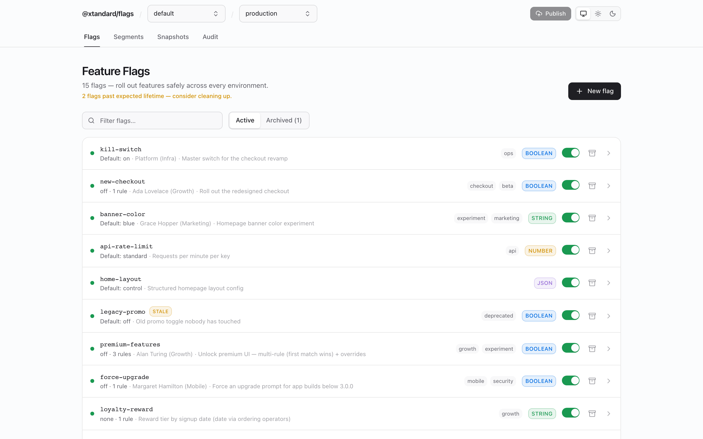
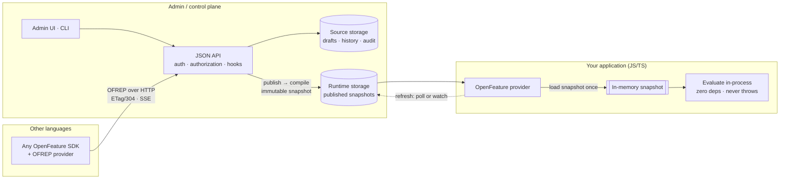

{/* The home page: written for the site; its content follows the root README.
scripts/sync.ts replaces the BASE, REPO and NPM tokens. */}

import { Card, CardGrid, LinkCard, Tabs, TabItem } from "@astrojs/starlight/components";

```sh
npm install @xtandard/flags
```

Run it **standalone** (Docker or `npx @xtandard/flags serve`), **embed** the admin panel in the app
you already have (Elysia, Hono, Express, Bun, Next.js), or use its **OpenFeature provider** on its
own. One package: every integration is a subpath export whose dependencies are **optional peer
dependencies**, installed only when you use it.



:::tip[The control plane can be down, and your applications keep evaluating flags]
After the first load, evaluation is fully in-process. If storage drops afterwards, the provider
serves the **last-known-good** snapshot (marked `stale`).
:::

## Why another flag tool?

Unleash, Flagsmith and GO Feature Flag are great, but most assume a server in (or near) the request
path and a heavier deployment. `@xtandard/flags` owns a narrower gap:

<CardGrid>
  <Card title="Self-hosted OpenFeature admin" icon="seti:config">
    Your data, your infrastructure, no SaaS. A bundled admin SPA: mounting the panel does not make
    you install React.
  </Card>
  <Card title="Pluggable storage" icon="seti:db">
    Memory, file, Redis, Postgres, MongoDB, SQLite, libSQL/Turso, Cloudflare KV, Drizzle or any
    unstorage driver. Bring your own with four methods.
  </Card>
  <Card title="Local-first evaluation" icon="rocket">
    A tiny, zero-dependency evaluator and provider run in-process. Deterministic splits, never
    throws, keeps serving when the panel is offline.
  </Card>
  <Card title="Any language, a standard protocol" icon="random">
    Other languages evaluate over OFREP: point any OpenFeature SDK's generic OFREP provider at the
    panel. ETag/304 caching and an opt-in SSE stream.
  </Card>
</CardGrid>

It is intentionally _not_ a LaunchDarkly clone: no experiment analytics, no hosted SaaS, no
mandatory Redis, Postgres or auth. Batteries included, not required: everything official
implements a public contract you can replace. [Why & how it works →](@BASE@/why/)

## A quick taste

<Tabs syncKey="home-taste">
<TabItem label="Mount the panel">

```ts
import { Hono } from "hono";
import { flagsPanel } from "@xtandard/flags/hono";
import { createRedisStorage } from "@xtandard/flags/storage/redis";
import { basicAuth } from "@xtandard/flags/auth/basic";

const app = new Hono();
app.route(
  "/flags",
  flagsPanel({
    basePath: "/flags",
    sourceStorage: createRedisStorage({ url: process.env.REDIS_URL!, prefix: "flags:source" }),
    runtimeStorage: createRedisStorage({ url: process.env.REDIS_URL!, prefix: "flags:runtime" }),
    auth: basicAuth({
      users: [{ username: "admin", passwordHash: process.env.FLAGS_ADMIN_PASSWORD_HASH! }],
    }),
  }),
);
export default app;
```

Open `/flags`, create a flag, and **Publish**: the draft compiles into an immutable snapshot in
runtime storage. [Framework adapters →](@BASE@/integrations/adapters/)

</TabItem>
<TabItem label="Evaluate (OpenFeature)">

```ts
import { OpenFeature } from "@openfeature/server-sdk";
import { createOpenFeatureProvider } from "@xtandard/flags/openfeature";
import { createRedisStorage } from "@xtandard/flags/storage/redis";

OpenFeature.setProvider(
  createOpenFeatureProvider({
    projectKey: "default",
    environmentKey: "production",
    storage: createRedisStorage({ url: process.env.REDIS_URL!, prefix: "flags:runtime" }),
    refreshIntervalMs: 10_000,
  }),
);

const client = OpenFeature.getClient();
const enabled = await client.getBooleanValue("new-checkout", false, {
  targetingKey: user.id,
  country: user.country,
  plan: user.plan,
});
```

The provider loads the whole snapshot once and evaluates from memory; a background refresh (poll
or watch) picks up new publishes. [OpenFeature provider →](@BASE@/evaluation/openfeature/)

</TabItem>
<TabItem label="Test it">

```ts
import { OpenFeature } from "@openfeature/server-sdk";
import { createOpenFeatureProvider } from "@xtandard/flags/openfeature";
import { booleanFlag, createTestPanel, publishFlags } from "@xtandard/flags/testing";

const { core, runtimeStorage } = createTestPanel(); // in-memory source + runtime stores
await publishFlags(core, [
  booleanFlag("new-checkout", {
    rules: [
      {
        id: "pro-in-latam",
        conditions: [
          { attribute: "country", operator: "in", value: ["CO", "MX", "BR"] },
          { attribute: "plan", operator: "equals", value: "pro" },
        ],
        serve: { variant: "on" },
      },
    ],
  }),
]);

await OpenFeature.setProviderAndWait(createOpenFeatureProvider({ storage: runtimeStorage }));
const client = OpenFeature.getClient();
await client.getBooleanDetails("new-checkout", false, {
  targetingKey: "user-42",
  country: "CO",
  plan: "pro",
}); // { value: true, variant: "on", reason: "TARGETING_MATCH", … }
```

No Redis, no server: `@xtandard/flags/testing` spins up an in-memory panel and builds flags
fluently. [Testing →](@BASE@/operations/testing/)

</TabItem>
<TabItem label="Any language (OFREP)">

```python
# pip install openfeature-sdk openfeature-provider-ofrep
from openfeature import api
from openfeature.contrib.provider.ofrep import OFREPProvider

api.set_provider(OFREPProvider(base_url="https://flags.example.com"))
enabled = api.get_client().get_boolean_value("new-checkout", False, ctx)
```

Go, Python, Rust, Java, .NET… evaluate over the OpenFeature Remote Evaluation Protocol, with no
vendor SDK. [Remote evaluation (OFREP) →](@BASE@/evaluation/ofrep/)

</TabItem>
</Tabs>

## How it fits together

Two planes. The **admin / control plane** (UI, JSON API, CLI) edits drafts in source storage and
publishes immutable snapshots to runtime storage. The **application runtime** loads a whole
snapshot into memory and evaluates in-process, so the panel is never in the request path.



Every flag is variant-based, and evaluation follows a fixed order: enabled → schedule window →
prerequisites → exact overrides → targeting rules (first match wins) → fallthrough. Splits are
deterministic (MurmurHash3 on the flag key, the targeting key and a salt).
[The flag model →](@BASE@/concepts/flag-model/)

## Where to next

<CardGrid>
  <LinkCard title="Getting started" href="@BASE@/getting-started/" description="Install, embed the panel or run it standalone, create and publish a flag, and evaluate it." />
  <LinkCard title="Architecture" href="@BASE@/concepts/architecture/" description="The two planes, source vs runtime storage, snapshots and memory-first evaluation." />
  <LinkCard title="Condition operators" href="@BASE@/concepts/operators/" description="AND/OR/NOT groups, dates, semver, custom comparators, query matchers, segments and prerequisites." />
  <LinkCard title="Storage" href="@BASE@/storage/" description="The four-method contract, every official backend, change notifications and choosing one." />
  <LinkCard title="Authentication & authorization" href="@BASE@/access/authentication/" description="None, basic or delegated auth; role-based or delegated authorization of every action." />
  <LinkCard title="Hooks" href="@BASE@/integrations/hooks/" description="Before/after control-plane hooks: logs, signed webhooks, publish gates and an evaluation sink." />
  <LinkCard title="Admin UI" href="@BASE@/ui/" description="The bundled SPA, branding, snapshots download/import, or embedding it as a React component." />
  <LinkCard title="Deployment" href="@BASE@/operations/deployment/" description="The standalone server, the Docker image, env vars per storage driver, and security notes." />
</CardGrid>

## The xtandard ecosystem

`@xtandard/flags` is one of a family of open-source, MIT-licensed projects that share the xtandard
name. They are independent of each other: use any of them on its own.

<CardGrid>
  <LinkCard
    title="@xtandard/lib"
    href="https://me.xantiagoma.com/xtandard/"
    description="Lightweight, type-safe TypeScript utilities with a zero-dependency core."
  />
  <LinkCard
    title="@xtandard/webhooks"
    href="https://me.xantiagoma.com/xtandard-webhooks/"
    description="Self-hosted, Standard Webhooks-compliant outbound webhooks: a Svix alternative as a library."
  />
  <LinkCard
    title="@xtandard/audit"
    href="https://me.xantiagoma.com/xtandard-audit/"
    description="Self-hosted, tamper-evident audit logs for B2B SaaS: a WorkOS Audit Logs alternative as a library."
  />
  <LinkCard
    title="@xtandard/links"
    href="https://me.xantiagoma.com/xtandard-links/"
    description="Self-hosted branded short links with click analytics, conversions and deep links: a Dub alternative as a library."
  />
  <LinkCard
    title="@xtandard/entitlements"
    href="https://me.xantiagoma.com/xtandard-entitlements/"
    description="Plans, entitlements and usage metering for TypeScript apps, as a library."
  />
  <LinkCard
    title="@xtandard/xyte"
    href="https://me.xantiagoma.com/xyte/"
    description="A Zyte API-compatible /v1/extract client and server on any proxy provider, or none."
  />
  <LinkCard
    title="xtandard-image"
    href="https://me.xantiagoma.com/xtandard-image/"
    description="Self-hosted image and video processing in Go and libvips, with imgproxy-compatible URLs."
  />
</CardGrid>

All of them, with npm and GitHub links: [the xtandard ecosystem](@BASE@/project/ecosystem/).
